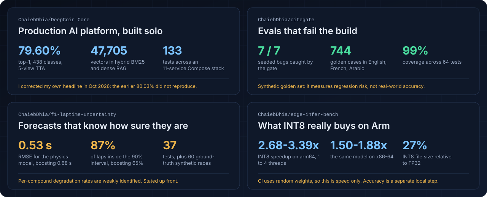
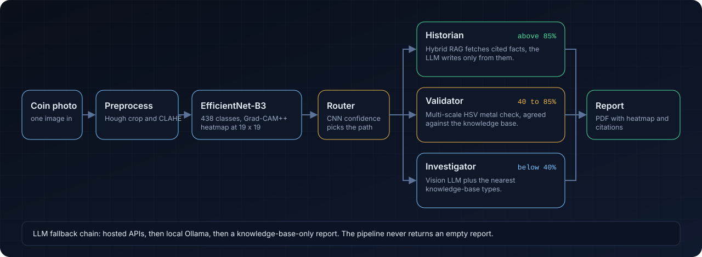
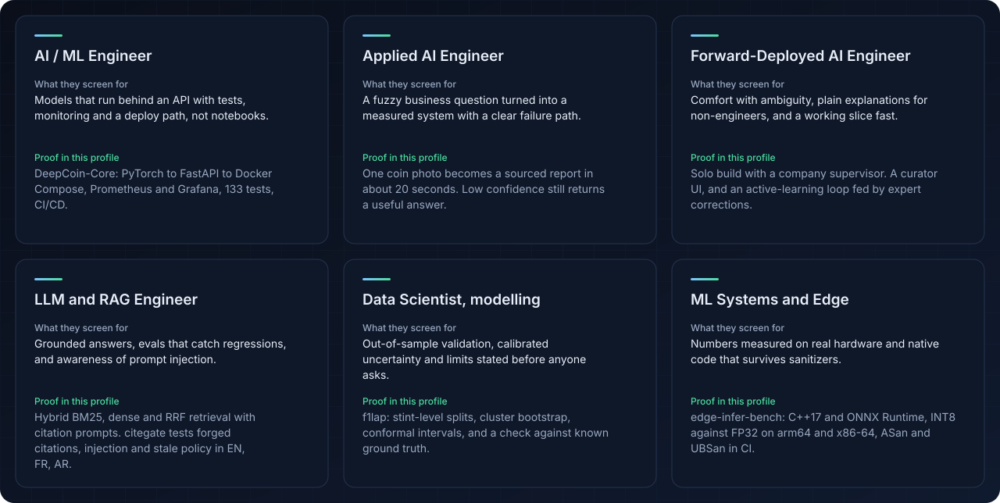
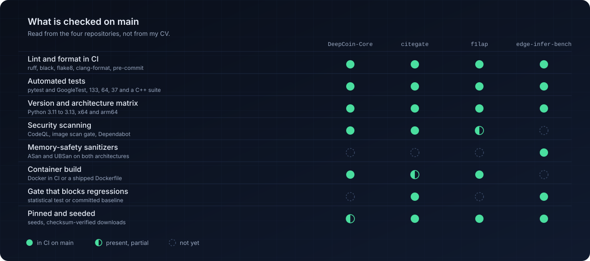
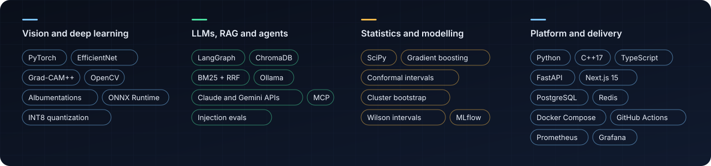
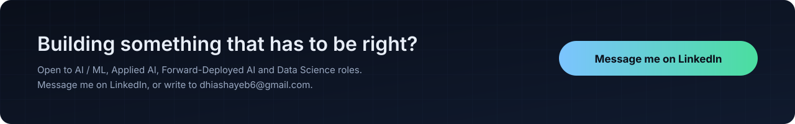

<a href="https://www.linkedin.com/in/dhia-shayeb/">LinkedIn</a> ·
<a href="mailto:dhiashayeb6@gmail.com">dhiashayeb6@gmail.com</a> ·
<a href="https://dhiashayeb.vercel.app">Portfolio</a>

Also appears as Dhia Shayeb on LinkedIn.

---

## Four repositories, four kinds of proof

[DeepCoin-Core](https://github.com/ChaiebDhia/DeepCoin-Core) ·
[citegate](https://github.com/ChaiebDhia/citegate) ·
[f1lap](https://github.com/ChaiebDhia/f1-laptime-uncertainty) ·
[edge-infer-bench](https://github.com/ChaiebDhia/edge-infer-bench)

Every repo states its own limits. DeepCoin-Core opens with the [corrections I published](https://github.com/ChaiebDhia/DeepCoin-Core#corrections-oct-2026) after my re-evaluation.

---

## DeepCoin-Core: one photo in, a sourced report out

My graduation project at YEBNI (Feb to Aug 2026), built solo. It identifies ancient coins, shows where the model looked, and writes a report grounded in a knowledge base instead of the LLM's memory. It runs on local models (Ollama) on a 4 GB GPU, so paid APIs are optional.

---

## Where I fit

---

## Engineering that can be checked

---

---

## Experience and education

**AI Engineer, final-year placement** · YEBNI, Tunisia · Feb to Aug 2026
Sole architect of DeepCoin-Core, from model training to monitored deployment.

**Software Engineer Intern** · Tunisie Telecom · Jun to Aug 2025
Network automation in Python with Netmiko, and a real-time KPI dashboard.

**ESPRIT, Tunis** · Engineering degree, Intelligent Software Engineering (EUR-ACE, BAC+5) · 2023 to 2026
**ISIK, Le Kef** · BSc Computer Science, Software Engineering · 2020 to 2023

Oracle OCI Associate · AWS Academy Cloud Foundations · Aviatrix ACE Multi-Cloud · Anthropic Agent Skills

---

