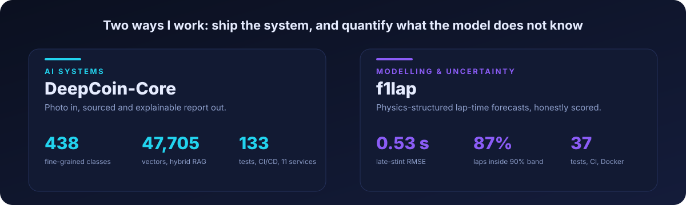
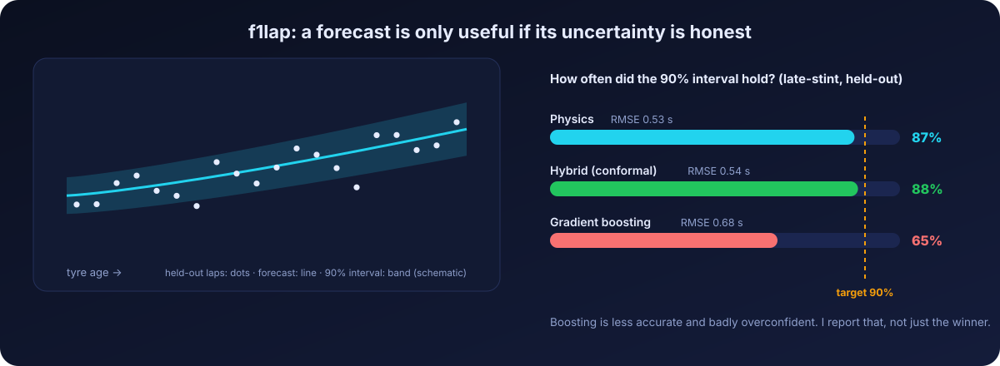
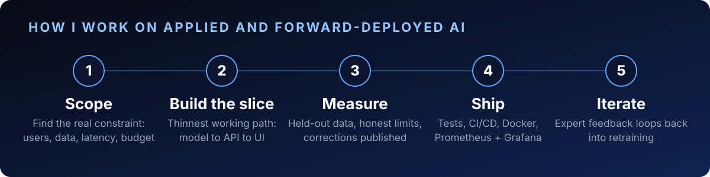
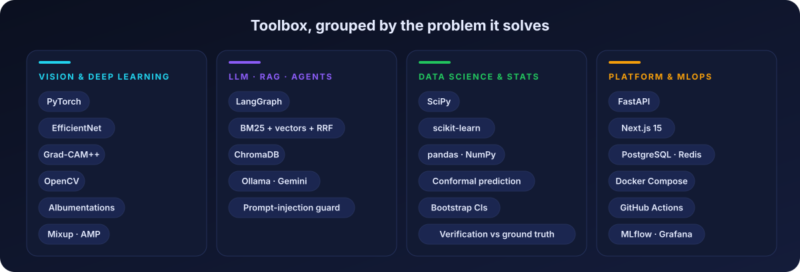

**AI systems you can trust, and forecasts that say how sure they are.**
Tunis · Arabic, French, English · **Relocating (visa sponsorship needed): UK · EU · Gulf · Singapore · Japan**

---

## 1. AI systems: [DeepCoin-Core](https://github.com/ChaiebDhia/DeepCoin-Core)

> One coin photo in. A sourced, explainable report out. About 20 seconds, on local models.

My ESPRIT graduation project, built at YEBNI (Feb to Aug 2026). It identifies ancient coins, shows where the model looked, and writes a report grounded in a knowledge base instead of the LLM's memory.

| | |
|---|---|
| **Vision** | EfficientNet-B3 (PyTorch), 438 classes, **79.60%** top-1 with 5-view TTA on a 1,152-image held-out set (79.25% single pass) |
| **Explainability** | Grad-CAM++ heatmaps (19 x 19) in every PDF report and in the web UI |
| **Agents** | 5 LangGraph agents; the CNN's confidence decides the route |
| **Retrieval** | Hybrid BM25 + ChromaDB with Reciprocal Rank Fusion over 47,705 vectors (9,541 coin types) |
| **Product** | FastAPI, Next.js 15, PostgreSQL, Redis, JWT, rate limiting, active-learning loop |
| **MLOps** | MLflow, Docker Compose (11 services), GitHub Actions CI/CD, Prometheus / Alertmanager / Grafana, 133 tests |
| **Runs locally** | Ollama (gemma3:4b, qwen3-vl:4b) on a 4 GB GPU; paid APIs are optional |

**I audit my own numbers.** In October 2026 I re-ran the evaluation, found that the original headline (80.03%) did not reproduce, and published the corrections at the top of the [README](https://github.com/ChaiebDhia/DeepCoin-Core#corrections-oct-2026). Known gaps are listed there too: no load test, no third-party security audit, RAG faithfulness not yet benchmarked.

---

## 2. Modelling with honest uncertainty: [f1lap](https://github.com/ChaiebDhia/f1-laptime-uncertainty)

> Can a small physics-structured model forecast F1 race lap time, with *honest* uncertainty, better than a generic ML model?

Three models (physics-structured, gradient boosting, conformal hybrid) on public 2024 race data, scored out of sample on unseen stints and on late-stint extrapolation. Fully reproducible, 37 tests, CI and Docker.

 

- **Result.** Over 3 races (865 held-out late-stint laps), physics and hybrid reached 0.53 s and 0.54 s RMSE against 0.68 s for boosting, whose 90% intervals covered only 65% of laps.
- **Verification.** The fitting code was checked against 60 synthetic races with known parameters (95% intervals covered the truth 91.7% of the time, reported as is).
- **Decision support.** `f1lap strategy` ranks tyre strategies with parameter uncertainty carried through.
- **Limits, stated up front.** Per-compound degradation rates are weakly identified; green-flag laps are approximated from race-control messages.

[**Read the repo and the full report →**](https://github.com/ChaiebDhia/f1-laptime-uncertainty)

---

## What I can do for your team

| Role | What I bring | Evidence |
|---|---|---|
| **AI / ML Engineer** | Models and LLM systems that run, not notebooks | DeepCoin-Core: PyTorch, FastAPI, Next.js, Docker Compose, CI/CD |
| **Data Scientist, modelling and forecasting** | Reduced-order and ML models, validated out of sample, with checked uncertainty | f1lap: held-out stints, interval coverage, conformal hybrid, verification vs ground truth |
| **Applied AI / Forward-Deployed Engineer** | A fuzzy problem turned into a measured, working slice, explained plainly | Solo build with a company supervisor; sourced reports and a UI built for curators |
| **LLM / RAG Engineer** | Grounded generation you can check | Hybrid BM25 + vector retrieval with RRF, citation prompts, fallback chain |
| **Software Engineer (AI products)** | Full-stack delivery with tests and monitoring | Next.js 15 + TypeScript + FastAPI, 133 tests, Prometheus / Grafana |
| **MLOps Engineer** | Pipelines, tracking, observability | MLflow, GitHub Actions, 11-service Compose stack |

---

---

## More projects

| Project | What it does | Stack |
|---|---|---|
| [Overlord Pipeline](https://github.com/ChaiebDhia/overlord-ai-video-pipeline) | 5-stage multi-LLM video generation pipeline with word-level timestamps | TypeScript · Node.js · OpenAI · Whisper · FFmpeg |
| [SkillBridge](https://github.com/InnovativeSquad-PI-4TWIN4/PiWebInovativeSquad) | AI-augmented skill-exchange platform, team of 5 | React · Node.js · MongoDB · WebRTC · Gemini API |
| [DevOps Pipeline](https://github.com/ChaiebDhia/DevOps_SpringBoot) | 18-stage Jenkins CI/CD with quality gates | Jenkins · Docker · SonarQube · Prometheus · Grafana |

## Experience and education

**AI Engineer, final-year placement** · YEBNI, Tunisia · Feb to Aug 2026 · sole architect of DeepCoin-Core
**Software Engineer Intern** · Tunisie Telecom · Jun to Aug 2025 · network automation (Python, Netmiko) and a real-time KPI dashboard
**Full-Stack Intern** · Bright Soft · Jul to Aug 2022 · React and Node.js features, NLP document processing

**ESPRIT, Tunis** · Engineering degree, Intelligent Software Engineering (EUR-ACE, BAC+5) · 2023 to 2026
**ISIK, Le Kef** · BSc Computer Science, Software Engineering · 2020 to 2023
Oracle OCI Associate · AWS Academy Cloud Foundations · Aviatrix ACE Multi-Cloud · Anthropic Agent Skills

---

### Building something that has to be right? Let's talk.

 

